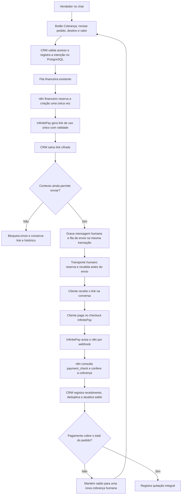
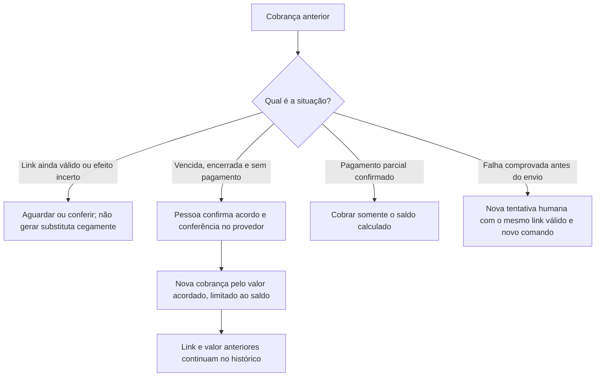

# Cobrança InfinitePay pelo chat

Fluxo do backend integrado à master em 08/11/2026. O botão no chat está em
protótipo local para avaliação. Flags reais permanecem desligadas.

## O que o vendedor acompanha

Gerando link → na fila → enviando → enviado → entregue são etapas do
transporte. Pagamento confirmado é um fato financeiro separado. Receber o
link ou abrir o checkout não quita o pedido.

Exemplo: pedido de R$ 1.200,00 com sinal de 30% gera R$ 360,00. Confirmado o
sinal, Cobrar saldo calcula R$ 840,00 no servidor, sem cobrar novamente o sinal.

## Correção, link anterior e falhas

Corrigir não cancela o link anterior na InfinitePay. O backend exige
vencimento/encerramento e conserva recebimentos; pagamento tardio exige
conferência. Resultado incerto não autoriza retry automático. Se o pagamento
chegar durante um envio já em andamento, ambos os resultados são preservados.

## Conta e ativação

A credencial privada da conta fica no n8n como `X-Api-Key`, acompanhada da
InfiniteTag da mesma conta. O workflow financeiro cria links e verifica
pagamentos; o transporte humano envia a mensagem. n8n não acessa o banco CRM.

Preparação e ativação estão no [runbook](../runbooks/order-billing.md).
Contratos: [BAPI-01–10](../../.specs/features/order-billing/spec.md) e
[ADR 076](../adr/076-intencoes-de-cobranca-e-envio-transacional.md).
Diagrama conferido contra `order-billing-chat-runtime.js`,
`order-billing-runtime.js`, `billing-send-guard.js` e os workflows locais.
